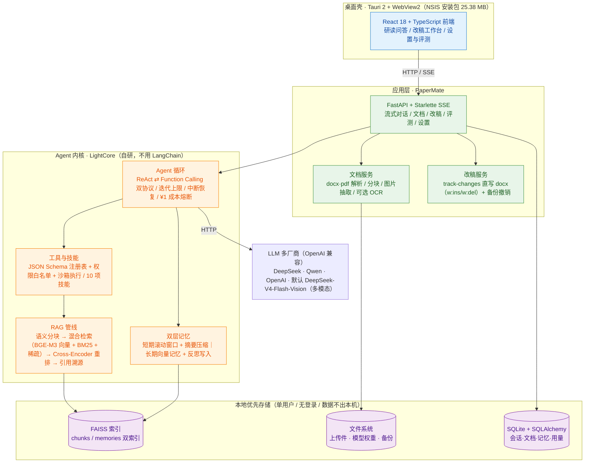

# PaperMate（论文智友）— 从零实现的学术论文研读 Agent 项目

> 一个面向简历的、从零搭建的大语言模型（LLM）智能体项目：自研轻量 Agent 框架 **LightCore** + 学术论文研读助手 **PaperMate**。


<a href="https://hhsh1010.github.io/PaperMate/" target="_blank" rel="noopener"></a>


---

## 项目是什么

**一句话**：本项目不依赖 LangChain/AutoGen 等高层 Agent 框架，从零实现一个可扩展的 Agent 内核（LLM 抽象、ReAct + Function Calling 循环、工具系统、双层记忆、规划反思、混合检索 RAG），并在其上构建一个面向科研场景的**学术论文研读助手**——支持论文问答（带引用溯源）、一键总结、相关工作挖掘、AI 改稿（Word 修订痕迹直写）。

**项目定位**：计算机技术硕士毕业前的"旗舰简历项目"，8 周核心 + 2 周可选增强。

## 架构总览



## 演示

**① 在线界面 demo（推荐，点开即用）**：👉
<a href="https://hhsh1010.github.io/PaperMate/" target="_blank" rel="noopener"><b>https://hhsh1010.github.io/PaperMate/</b></a>
（**新标签页打开**，看完随时切回本页）

- 打开就是真实前端界面，数据为**内置样例**，**不需要任何 API key、不连任何后端、零费用**；
- 由 [`.github/workflows/pages.yml`](.github/workflows/pages.yml) 以 `VITE_DEMO_MODE=1` 构建
  （[`web/src/demo/mock.ts`](web/src/demo/mock.ts) 拦截 `/api/v1/*` 并提供样例数据，连**流式回答**都模拟）；
  页面底部常驻一条「演示模式」横幅，避免把样例数据误当成真实运行结果。

**② 端到端 demo（证明链路真的跑得通）**：**Actions → `Demo` → Run workflow**

- 用内置 `fake` 模型**零密钥**跑完：上传解析 → SSE 流式问答 → 引用溯源 → 改稿（Word 修订痕迹）→ 导出双版本；
- 结果写入 **Job Summary**（页面上直接可读），导出的 `.docx` 作为 **artifact** 可下载 ——
  可在 Word 里亲手确认「修订痕迹真的写进去了」。

> 📌 待补：`docs/assets/` 下放 3 张截图（研读问答带引用 / 改稿工作台的修订对比 / 设置页功能模块）与一段 30s 录屏 GIF。
> 自建在线 Demo（临时隧道/云服务器）步骤见 [`deploy/DEMO_DEPLOY_RUNBOOK.md`](deploy/DEMO_DEPLOY_RUNBOOK.md)。

## 核心亮点（6 条）

1. **自研 Agent 内核**：ReAct 与 Function Calling 双协议、最大迭代/中断恢复/成本熔断；
2. **通用工具系统**：JSON Schema 注册表 + 权限白名单 + 沙箱执行，内置 12+ 工具，预留 MCP 扩展；
3. **双层记忆**：短期滚动窗口 + 摘要压缩；长期向量记忆 + 反思写入（Generative Agents 思想）；
4. **生产级 RAG**：语义分块 → 混合检索（BGE-M3 向量 + BM25）→ Cross-Encoder 重排 → 引用溯源；
5. **规划与反思**：Plan-then-Execute 分解 + Self-Critique 自我评估修复；
6. **工程化完备**：SSE 流式、成本统计、trace 可观测、评测体系、Docker 一键部署。

## 技术栈速览

Python 3.11 · uv · FastAPI · SSE 流式 · React 18 + Vite + TS · SQLite + SQLAlchemy · FAISS · BGE-M3 / BGE-reranker · OpenAI 兼容多模型（**DeepSeek-V4-Flash-Vision（多模态）** / DeepSeek / Qwen / OpenAI）· pytest + 自研评测 · Docker + Nginx

## 模型选型与配置

### 默认模型：DeepSeek-V4-Flash-Vision（多模态）

- **官方模型 id**：`deepseek-v4-flash-vision-exp`（实验性多模态视觉理解模型，2026-08-21 上线；文本能力与 V4-Flash 持平，多模态 Agent 能力接近 Opus-4.8）。
- **配置位置**：
  - 后端默认：`src/lightcore/llm/router.py` 中 `PRESET_ENDPOINTS["deepseek"].default_model`；
  - 运行时切换：设置页「全局默认」选 `deepseek-v4-flash-vision-exp`，或 `PUT /api/v1/settings` 写入 `default_model` / `providers.deepseek.model`；
  - 会话级：对话页/设置页会话覆盖选模型。
- **调用方式**：OpenAI 兼容 Chat Completions（`https://api.deepseek.com/v1`），与既有 `OAICompatibleLLM` 完全复用，无需新依赖；key 走 `DEEPSEEK_API_KEY`（环境变量或设置页，不入库）。
- **多模态输入**：对话输入区「🖼」按钮选择图片（JPEG/PNG/GIF/WebP，单张 ≤32MiB、单次 ≤10 张）→ base64 data URL 随消息发送；后端组装 OpenAI 兼容 content 块（`text` + `image_url`）。图片仅进入当前 user 消息（官方规范：图片仅限 user 消息）。
- **规格与计费**：上下文 1,000,000 tokens / 最大输出 384,000 tokens；图片按 ≤384 tokens/张 折算后随文本计费，价格与 V4-Flash 一致（本地成本估算 `_PRICING` 已收录）。
- **约束**：图片仅 `deepseek-v4-flash-vision-exp` 接受（发往其他 DeepSeek 模型返回 400）；fake 模型不真看图但链路可测。

### 其他可用模型

DeepSeek（`deepseek-chat` / `deepseek-reasoner`）、Qwen（`qwen-plus/max/turbo/long`、`qwen3-max` 262K）、OpenAI（`gpt-4o` 系列）。厂商/模型目录见 `src/lightcore/llm/router.py` 的 `PRESET_ENDPOINTS` / `PROVIDER_MODELS`。

## 当前状态

- [x] 需求与架构设计完成（技术书 01–13 全稿 + 可行性论证）
- [x] 实施完成：M1 内核 → M2 记忆/RAG → M3.1 FastAPI+SSE → M3.2 React 前端 → 阶段 A（P0/P1 治理）→ 阶段 B（S3/S4）→ 阶段 C（S5/S6/S8）→ 阶段 D（S9/S10）；**后端 1685 单测 · 前端 261 单测全绿**（2026-10-05 实测）
- [ ] 工程收尾：CI 门禁（GitHub Actions）/ 横向模型接入（ERNIE/Claude）；Docker 部署文件已就绪（`deploy/`）

## 快速开始（本地运行）

> ⚠️ **本仓库不含运行数据**：`data/`（SQLite、上传的论文、FAISS 索引、日志）与 `.env`
> 均被 `.gitignore` 排除 ⇒ **克隆后是"空壳"**。数据目录会在首次启动时自动创建，
> 但**模型密钥要你自己配**。
>
> 💡 零密钥也能跑：默认模型是 `fake`（本地演示，无需任何 key 即可跑通 Agent 内核与 SSE）。

1. **装依赖**（uv 统一管理；`rag` = 检索链路，`dev` = 测试与 lint）
   ```bash
   uv sync --extra rag --extra dev
   ```
2. **配密钥**（三选一，优先级：会话配置 > 运行时设置 > `.env`）
   ```bash
   cp .env.example .env      # 按注释填 DEEPSEEK_API_KEY / DASHSCOPE_API_KEY 等
   ```
   也可直接在**设置页 → 模型与厂商**填写（写入 `data/provider_settings.json`，该文件不入库）。
3. **起后端**（自动建 `data/` 并初始化 SQLite）
   ```bash
   python -m papermate.api          # 默认 127.0.0.1:8000
   ```
4. **起前端**
   ```bash
   cd web && npm install && npm run dev
   ```
5. **建库并使用**：上传 PDF → 等待「解析 / 分块 / 向量化」完成 → 在对话页提问（回答带引用溯源）。

### 可选：模型下载与 GPU 加速

检索使用 `BGE-M3` + `bge-reranker-v2-m3`，首次运行会自动下载。
国内访问 HuggingFace 受限时设置镜像：

```bash
export HF_ENDPOINT=https://hf-mirror.com        # PowerShell：$env:HF_ENDPOINT="https://hf-mirror.com"
```

GPU 加速由 `PAPERMATE_DEVICE=cuda` 触发；未设置时按 `cuda → cpu` 自动回落。
冷启动建议 `PAPERMATE_PREWARM_DOCS=1`（提前预热模型，省得首问等待）。

### 目录约定：什么会进仓库、什么不会

| 路径 | 入库 | 说明 |
|---|:---:|---|
| `src/` `tests/` `eval/*.py` `web/src/` | ✅ | 源码与测试 |
| `eval/cases/*.jsonl` | ✅ | gold 评测集 —— ⚠️ **指纹按原始字节计算，不要改行尾** |
| `data/` | ❌ | 数据库、上传论文、索引、日志、**含明文密钥的 `provider_settings.json`** |
| `.env` | ❌ | 密钥 |
| `web/dist/` `web/node_modules/` `.venv/` | ❌ | 构建产物与依赖 |
| `.workbuddy/` | ❌ | 项目工作记忆（本地私有） |

### 门禁

**本地（发布前全量）**：

```bash
.venv/Scripts/python.exe -m ruff check src tests     # 静态检查
.venv/Scripts/python.exe scripts/run_tests.py        # 后端全量（带单实例锁）
cd web && npm run typecheck && npm test && npm run build
```

**CI（push / PR 自动跑）**：见 [`.github/workflows/ci.yml`](.github/workflows/ci.yml) —— 三个并行 job：
`ruff check` · `tsc + vitest + build` · `pytest -m "not slow"`（后端只装基础依赖，torch/faiss 等 [rag] 重量级依赖不进 CI，
缺依赖的用例由 `pytest.importorskip` 优雅跳过；`slow` 用例留在本地发布门禁）。

## 文档地图（全部文档保存在本仓库）

### 📖 技术书（共 12 章）

| 章节 | 文件 | 内容 |
|---|---|---|
| 01 | [docs/技术书/01-总览与背景.md](docs/技术书/01-总览与背景.md) | 项目背景、目标、范围、风险、名词表 |
| 02 | [docs/技术书/02-生态调研与关键论文.md](docs/技术书/02-生态调研与关键论文.md) | Agent 领域时间线、论文地图、框架对比 |
| 03 | [docs/技术书/03-需求分析.md](docs/技术书/03-需求分析.md) | 场景故事、FR/NFR、优先级、验收指标 |
| 04 | [docs/技术书/04-总体架构与技术选型.md](docs/技术书/04-总体架构与技术选型.md) | 分层架构、数据流时序、选型理由、目录结构 |
| 05 | [docs/技术书/05-核心模块详细设计.md](docs/技术书/05-核心模块详细设计.md) | ★ 各模块类设计、伪代码、边界与测试要点 |
| 06 | [docs/技术书/06-数据与存储设计.md](docs/技术书/06-数据与存储设计.md) | ER 模型、表结构 SQL、向量索引设计 |
| 07 | [docs/技术书/07-实施路线图.md](docs/技术书/07-实施路线图.md) | 10 周里程碑、验收标准、风险对策 |
| 08 | [docs/技术书/08-测试与质量保障.md](docs/技术书/08-测试与质量保障.md) | 三级测试、评测体系、CI 门禁 |
| 09 | [docs/技术书/09-部署运维与可观测性.md](docs/技术书/09-部署运维与可观测性.md) | Docker 部署、日志、trace、监控告警 |
| 10 | [docs/技术书/10-成本安全与合规.md](docs/技术书/10-成本安全与合规.md) | 成本模型、安全威胁模型、合规 |
| 11 | [docs/技术书/11-简历呈现与面试指南.md](docs/技术书/11-简历呈现与面试指南.md) | 简历写法、面试 20 问、Demo 脚本 |
| 12 | [docs/技术书/12-附录-参考资料.md](docs/技术书/12-附录-参考资料.md) | 论文清单、官方文档、阅读路线 |
| 13（增补） | [docs/技术书/13-可行性分析报告.md](docs/技术书/13-可行性分析报告.md) | 五维可行性论证、三档排期预案、第 0 周 Spike 验证计划 |
| 14（增补） | [docs/技术书/14-真实使用场景.md](docs/技术书/14-真实使用场景.md) | 10 个真实使用场景（用户→动作→期望结果）、场景覆盖矩阵 |

### 📋 配套文档

| 文档 | 文件 |
|---|---|
| GitHub 热门 Agent 项目调研报告 | [docs/调研报告-GitHub热门Agent项目.md](docs/调研报告-GitHub热门Agent项目.md) |

## 快速开始（实施阶段）

1. 阅读 [技术书 01](docs/技术书/01-总览与背景.md) 了解全局；
2. 按 [技术书 07 路线图](docs/技术书/07-实施路线图.md) 从第 1 周开始实施；
3. 每一模块的实现细节对照 [技术书 05 详细设计](docs/技术书/05-核心模块详细设计.md)；
4. 完成后按 [技术书 08](docs/技术书/08-测试与质量保障.md) 跑评测、按 [技术书 09](docs/技术书/09-部署运维与可观测性.md) 部署，最后按 [技术书 11](docs/技术书/11-简历呈现与面试指南.md) 呈现到简历。

## License

MIT（代码部分）；文档归作者所有，欢迎引用。
