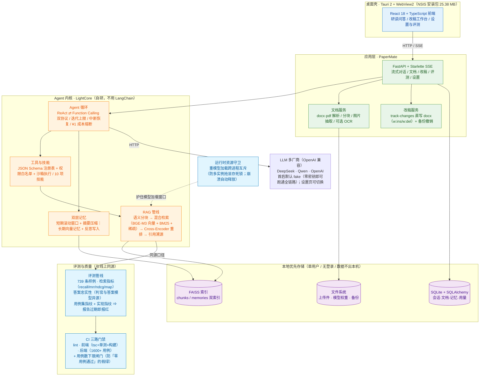
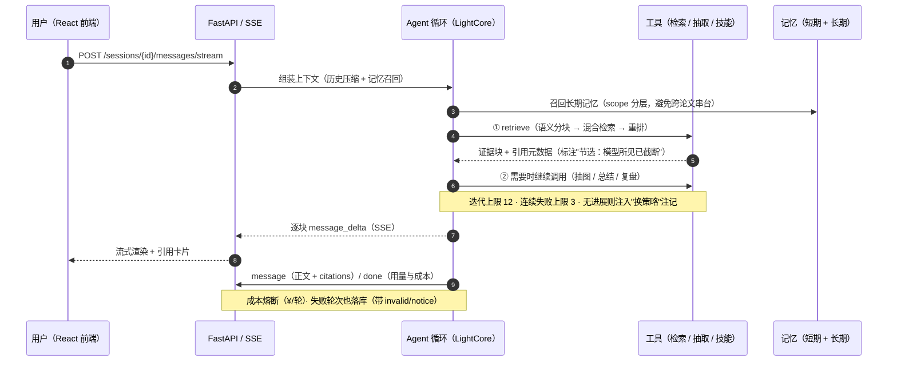

# PaperMate（论文智友）

> **从零实现的学术论文研读 Agent** —— 不依赖 LangChain / AutoGen 等高层框架，自研 Agent 内核
> **LightCore**（LLM 抽象 · ReAct + Function Calling 循环 · 工具与权限 · 双层记忆 · 规划反思 · 混合检索 RAG），
> 在其上构建面向科研场景的论文研读与改稿助手。
>
> **三个差异化点**：① 回答**带原文引用溯源**（并如实标注"模型所见已截断"）；
> ② 改稿**以 Word 修订痕迹直写 docx**（可逐条核对、可一键撤销）；
> ③ **评测与实现同源 + 指纹校验**：改了检索实现不重跑评测，门禁会自己报"报告已过时"。
>
> **可验证**：零密钥在线 Demo（点开即用）· CI 三路门禁全绿 · 端到端可复现 Demo（Actions 一键跑通全链路）。


<a href="https://hhsh1010.github.io/PaperMate/open-demo.html" target="_blank" rel="noopener"></a>


---

## 演示

**① 在线界面 Demo（推荐，点开即用）**：👉
<a href="https://hhsh1010.github.io/PaperMate/open-demo.html" target="_blank" rel="noopener"><b>点此在新窗口打开 Demo</b></a>

- 打开的是**真实前端界面**，数据为**内置样例**：**不需要任何 API key、不连任何后端、零费用**；
- 页面底部常驻「演示模式」横幅，避免把样例数据误当成真实运行结果；
- 链接先经过一个[中转页](https://hhsh1010.github.io/PaperMate/open-demo.html)（点一下按钮即弹出独立窗口 ——
  浏览器要求弹窗必须由点击触发）；直链（新标签页）：<a href="https://hhsh1010.github.io/PaperMate/" target="_blank" rel="noopener">hhsh1010.github.io/PaperMate/</a>
- 由 [`.github/workflows/pages.yml`](.github/workflows/pages.yml) 以 `VITE_DEMO_MODE=1` 构建，
  [`web/src/demo/mock.ts`](web/src/demo/mock.ts) 拦截 `/api/v1/*` 并提供样例数据（连**流式回答**都模拟）。

**② 端到端 Demo（证明链路真的跑得通）**：**Actions → `Demo` → Run workflow**

- 用内置 `fake` 模型**零密钥**跑完：上传解析 → SSE 流式问答 → 引用溯源 → 改稿（Word 修订痕迹）→ 导出双版本；
- 结果写入 **Job Summary**（页面上直接可读），导出的 `.docx` 作为 **artifact** 可下载
  —— 可在 Word 里亲手确认"修订痕迹真的写进去了"。

## 亮点速览

> 一句话：**这是一个能装到你电脑上、能改你真实论文、并且能让你验证它有多准的 Agent 应用** —— 不是又一个聊天壳。

1. **桌面应用，装完即用**（不是"克隆源码跑 demo"）：Windows 安装包 **25.38 MB**（Tauri 2 + 内置 Python 副本）。
   首启**零密钥**即可完整体验；重量级模型（约 4GB）与真实模型 key 都在应用内**按需开启，不会静默下载**。
2. **能改真实论文文件**：改稿以 **Word 修订痕迹（`w:ins` / `w:del`）直写 `.docx`**，
   可逐条接受/拒绝、可一键撤销（带备份链）—— 而不是"给你一段文本自己粘贴"。
3. **引用可溯源且诚实**：每个回答带引用卡片；当模型只看到被截断的块时，卡片会**如实标注**
   「节选：模型所见已被截断」，不假装看全了。
4. **评测与实现同源，且有指纹门禁**：评测走与线上同一条管线；报告绑定**用例集指纹 + 实现指纹**
   ⇒ **改了检索实现却不重跑评测，门禁会自己报"报告已过时"**（而不是让旧数字一直挂在那儿）。
5. **结论可查，包括被推翻的那条**：公开消融实验（6 配置 × 221 例）给出"重排 512 不可降"等结论；
   其中"稀疏检索零收益"在**真实论文复核时未复现** ⇒ **主动回滚、不采纳** —— 收益未证就不改产品。
6. **数据不出本机**：本地优先、无登录；密钥走环境变量或应用内设置且**不入库**；
   成本**按轮熔断**（默认 ¥1/轮）并全量留痕。

## 快速开始

### 方式一：安装桌面应用（推荐，零环境依赖）

1. 打开 **[Releases](https://github.com/hhsh1010/PaperMate/releases/latest)** 下载**最新安装包**
   （`PaperMate_x.y.z_x64-setup.exe`，约 25 MB）；
2. 双击安装 → 打开即用（**Windows 10/11**；WebView2 在 Win11 自带，Win10 如缺失安装程序会引导）；
3. 首启**不需要任何 API key**：默认 `fake` 模型即可走完「上传 → 问答（带引用）→ 改稿」全流程。

> - 要**真实回答**：应用内「设置 → 模型与厂商」填 key（也可以不填，走离线确定性回退）；
> - 要**真实语义检索**：「设置 → 语义检索」点「下载模型」（约 4GB）→ 下载完手动启用 → 重建索引。
> - 非 Windows 平台暂无安装包，走下面「方式二」。

### 方式二：从源码运行（开发 / 贡献）

需要 **Python 3.11+** 与 **Node 18+**：

```bash
uv sync --extra rag --extra dev          # rag = 检索链路；dev = 测试与 lint
python -m papermate.api                  # 后端，默认 127.0.0.1:8000
cd web && npm install && npm run dev     # 前端
```

> ⚠️ 克隆后是「空壳」：`data/`（数据库 / 上传论文 / 索引 / 日志）与 `.env` 均被 `.gitignore` 排除，
> 首次启动会自动创建数据目录。**运行数据与密钥不进仓库。**
> 提交前的三层门禁与规范见 **[CONTRIBUTING.md](CONTRIBUTING.md)**。


## 架构



### 一次提问的链路（简化）



## 质量与验证

**测试与门禁**（2026-10-12 实测）

| 项 | 规模 | 说明 |
|---|---|---|
| 后端用例 | **1879 条**（CI 每次执行 `not slow` 子集 **1612 条**）| 含接口契约、检索/改稿回归、顺序依赖、并发契约 |
| 前端单测 | **310 条**（31 文件）| tsc + vitest + 构建 |
| CI 门禁 | **3 个 job，单次约 1 分钟** | lint / 前端 / 后端 **+ 用例数下限闸门**（防"零用例通过"的假绿）|

CI 配置见 [`.github/workflows/ci.yml`](.github/workflows/ci.yml)：三个 job 并行执行 `ruff check` ·
`tsc + vitest + build` · `pytest -m "not slow"`（后端只装基础依赖，torch/faiss 等 `[rag]` 重量级依赖不进 CI，
缺依赖的用例由 `pytest.importorskip` 优雅跳过；`slow` 用例留在本地发布门禁）。

**评测指标**（同一套用例，`--merge composite` 与线上同源）

| 指标 | 值 | 口径 |
|---|---|---|
| 检索 recall@5 / mrr@10 | **0.9672 / 0.8828** | 221 条 golden，2026-10-12 |
| 答案忠实性 faithfulness | **0.9818** | 165 条可判/162 命中，判官与答案模型**异源**，2026-09-27 |

> ⚠️ 诚实边界：**弃答率（abstention）未测出**（那轮 38 条负样本的判官调用全部因额度限制失败，
> 故报告里该项为 `None`）—— 未测出的指标不写进结论。
> 另有**消融实验**（6 配置 × 221 例，零 API 成本）：结论是"重排 512 不可降（384/256 明显掉质量而延迟只省百毫秒）"、
> "查询改写的收益不在检索层"等；其中一条"稀疏检索零收益"在**真实论文复核时未复现**，
> 因此**主动回滚、不采纳** —— 合成语料上的结论不外推到真实语料。

## 技术栈

Python 3.11 · uv · FastAPI + Starlette（SSE）· SQLAlchemy + SQLite · FAISS · BGE-M3 / bge-reranker-v2-m3 + BM25 + jieba ·
React 18 + Vite + TypeScript · Tauri 2（桌面端）· pytest + 自研评测管线 · Docker + Nginx · GitHub Actions

**模型**：OpenAI 兼容多厂商（DeepSeek / Qwen / OpenAI），可在设置页或 `.env` 切换；
首启默认 `fake`（零密钥）。厂商与模型目录见 `src/lightcore/llm/router.py` 的 `PRESET_ENDPOINTS` / `PROVIDER_MODELS`。

## 参与贡献

克隆后是「空壳」—— `data/`（数据库 / 上传论文 / 索引 / 日志）与 `.env` 均被 `.gitignore` 排除，
首次启动会自动创建数据目录；**运行数据与密钥不进仓库**。

提交前的门禁、评测语料指纹注意事项、提交规范等，见 **[CONTRIBUTING.md](CONTRIBUTING.md)**。

## 文档与许可

- 设计文档（技术书 12+ 章：架构与技术选型、核心模块详细设计、数据与存储、测试与质量、部署与可观测性、
  成本安全与合规、可行性分析等）**保存在本地，未随本仓库发布**。
- 代码以 **MIT** 许可开源；文档归作者所有，欢迎引用。

## License

MIT
